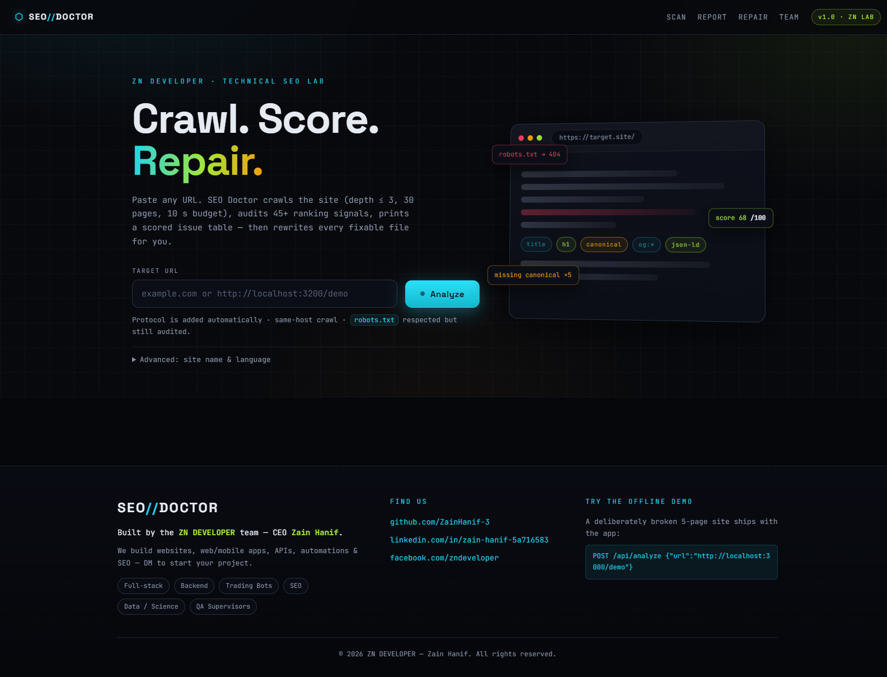
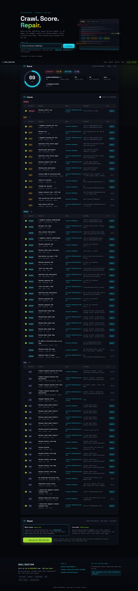
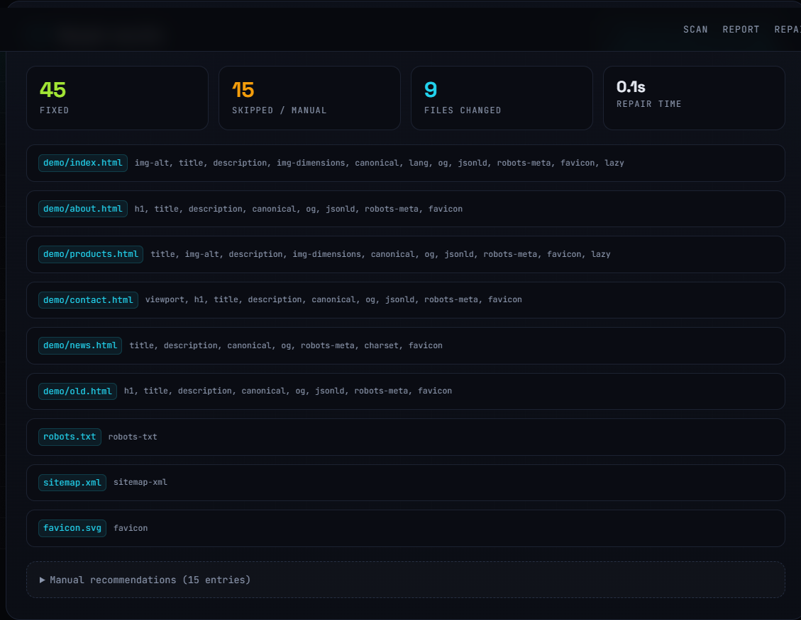
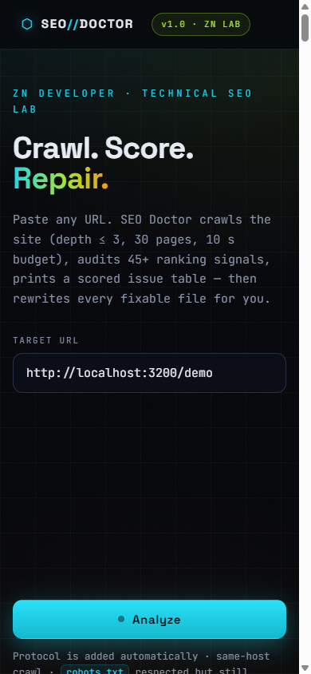

# SEO Doctor

**Crawl. Score. Repair.** Paste any URL — SEO Doctor crawls the whole site (depth ≤ 3, 30 pages, 10 s budget), audits 45+ ranking signals across 34 rule families, prints a scored issue table, then rewrites every fixable file in one click. Ships with a deliberately broken offline demo site so you can see the full pipeline in 30 seconds.

> **Safety first:** the default **Mirror** mode never touches a live site — it downloads the crawled HTML/CSS/assets, repairs the local copy, and hands you a `.zip` + HTML diff report. The **Live** (FTP) mode uploads only the files it changed and requires typing `confirm` plus ticking an explicit permission checkbox. **Only ever run Live mode against sites you own or are authorized to edit.**

---

## Features

- **Crawler** — same-host BFS, `robots.txt` respected for crawl but still audited for problems, manual redirect chains (reports hops like 301→301→200), probes for `/robots.txt`, `/sitemap.xml`, `/favicon.ico` and a canary path, budget limits (pages / depth / ms), concurrency 4.
- **34 rule families (45+ checks)** in 5 categories:

| Category | Rules |
|---|---|
| Metadata | `title` (missing / duplicate / short / long), `description` (missing / short / duplicate), `canonical`, `robots-meta`, `keyword-title`, `keyword-description` |
| Content | `h1` (missing / multiple), `heading-skip`, `thin` (word count), `img-alt`, `img-dimensions`, `inline-css`, `lazy` (lazy-loading) |
| Social | `og` (Open Graph + Twitter cards per page) |
| Structured data | `jsonld` (WebSite / Organization / BreadcrumbList presence), `jsonld-invalid`, `breadcrumb` |
| Technical | `viewport`, `charset`, `lang`, `favicon`, `theme-color`, `robots-txt`, `sitemap-xml`, `link-broken`, `page-status` (4xx/5xx), `page-404`, `page-weight`, `redirect-chain`, `http-https`, `mixed-content`, `www-inconsistency`, `hreflang`, `robots-blocked` |

- **Scored report** — severity weights (critical 10 / high 6 / medium 3 / low 1) → 0–100 health score, grouped issue tables with evidence, page lists and repair advice, per-issue or bulk selection.
- **15 auto-fixers** — `title`, `description`, `canonical`, `robots-meta`, `viewport`, `charset`, `lang`, `h1`, `img-alt`, `img-dimensions`, `og`, `favicon`, `jsonld`, `lazy` (per page) + `robots-sitemap` (generates `robots.txt` + `sitemap.xml` for the whole site).
- **Mirror mode (default)** — repaired tree under `sites/<host>/`, per-file before/after diffs, `SEO-DOCTOR-DIFF.html` report, downloadable `.zip`.
- **Live mode (FTP)** — uploads only changed files via `basic-ftp`; credentials used in memory for that run only — never stored, never logged.
- **Reports API** — in-memory store keeps the last 20 reports; `/api/stats` returns totals.

## Install & run

```bash
npm install
npm start          # http://localhost:3000
npm run dev        # same, with --watch
PORT=3200 npm start
npm test           # node --test (30/30 passing)
```

Node.js ≥ 18 required (uses built-in `fetch`).

## Demo walkthrough (offline, zero setup)

A 5-page broken fixture is served by the app itself at `/demo` — missing descriptions, duplicate/missing/oversized titles, a missing H1, broken internal link, redirect chain, invalid JSON-LD, no viewport, no lang, no favicon, no `robots.txt`, no `sitemap.xml`, no Open Graph, no canonical:

```bash
# 1. Analyze the broken demo
curl -s -X POST http://localhost:3000/api/analyze \
  -H "Content-Type: application/json" \
  -d '{"url":"http://localhost:3000/demo"}'
# → score 69/100 · 7 pages · 60 issues (1 critical, 14 high, 23 medium, 22 low)

# 2. Repair everything into a local mirror
curl -s -X POST http://localhost:3000/api/optimize \
  -H "Content-Type: application/json" \
  -d '{"reportId":"<id from step 1>","mode":"mirror"}'
# → 45 fixed · 15 skipped (manual/advice) · 9 files changed · zipUrl

# 3. Download the repaired site
curl -sOJ http://localhost:3000/api/download/<id>
```

Or just open `http://localhost:3000/`, paste `http://localhost:3000/demo`, hit **Analyze**, then **Optimize all**.

Live mode is rejected without confirmation (verified):

```bash
curl -s -X POST http://localhost:3000/api/optimize/live \
  -H "Content-Type: application/json" \
  -d '{"reportId":"<id>","mode":"live","creds":{"host":"h","user":"u","password":"p"}}'
# → HTTP 400 {"error":"Live mode requires confirm:true — type the confirmation to proceed."}
```

## API

| Method | Route | Body | Returns |
|---|---|---|---|
| POST | `/api/analyze` | `{url, siteName?, lang?}` | report summary + issues + score |
| GET | `/api/report/:id` | — | full stored report (pages, crawl, issues) |
| POST | `/api/optimize` | `{reportId, mode?, selected?, confirm?, permission?, creds?}` | `{fixed[], skipped[], diff[], zipUrl, stats}` |
| POST | `/api/optimize/live` | same as above (forces live) | same, plus `{uploaded}` |
| GET | `/api/download/:id` | — | `application/zip` repaired mirror |
| GET | `/api/stats` | — | report totals + uptime |
| GET | `/healthz` | — | `{ok:true}` |

`selected` (array of issue ids) limits the repair; empty/omitted = every repairable issue. Manual items are always returned under `skipped` with a reason (`manual recommendation`, `review needed`, `already present — no change needed`).

## Screenshots

| | |
|---|---|
|  |  |
|  |  |

## Project layout

```
seo-doctor/
├── server.js              Express app + API
├── src/
│   ├── crawler.js         BFS crawl, robots/redirects/probes
│   ├── parse.js           HTML parse + JSON-LD analysis
│   ├── scoring.js         severity weights → 0–100 score
│   ├── store.js           last 20 reports (data/reports.json)
│   ├── zip.js             archiver wrapper
│   ├── optimizer.js       mirror repair + FTP live upload + diffs
│   ├── audit/             meta · content · social · structured · technical
│   └── fixers/            15 auto-fixers
├── public/                frontend + built-in /demo fixture
└── test/                  node --test suite
```

## Tech stack

Node 18+ · Express 4 · cheerio · archiver · image-size · basic-ftp · vanilla HTML/CSS/JS frontend (no build step).

---

**Built by ZN DEVELOPER — CEO Zain Hanif.** We build websites, web/mobile apps, APIs, automations & SEO. DM us to start your project.

- GitHub: [github.com/ZainHanif-3](https://github.com/ZainHanif-3)
- LinkedIn: [linkedin.com/in/zain-hanif-5a716583](https://www.linkedin.com/in/zain-hanif-5a716583/)
- Facebook: [facebook.com/zndeveloper](https://www.facebook.com/zndeveloper)
