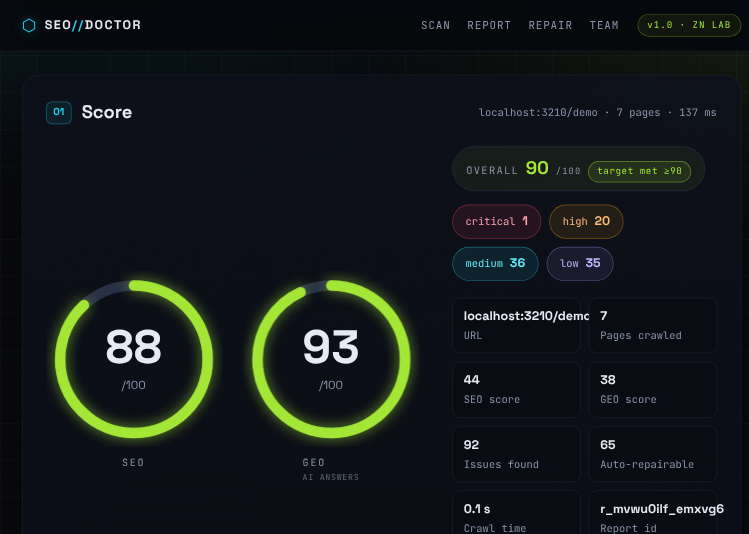
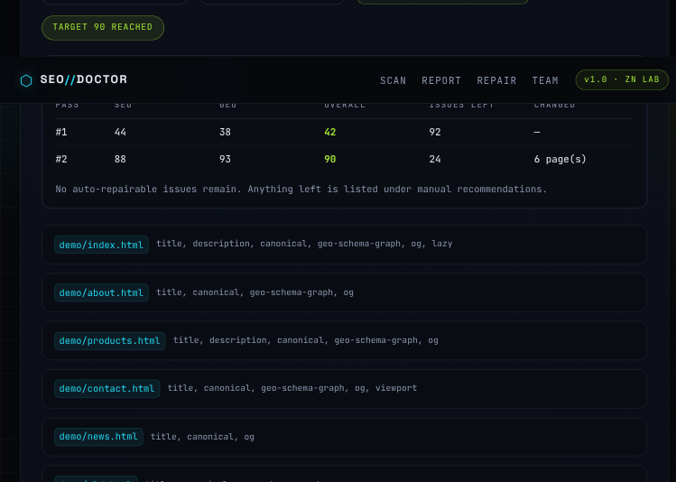

# SEO Doctor

**Crawl. Score. Improve. Repeat.** Paste any URL — SEO Doctor crawls the site (depth ≤ 3, 30 pages, 10 s budget), scores it on **two axes** (classic **SEO** and **GEO** — visibility to AI answer engines), and prints a scored issue table. Then **Improve** repairs every fixable file, re-crawls the repaired result, scores it again, and repeats until the target is hit or nothing fixable is left.

> **Safety first:** the default **Mirror** mode never touches a live site — it downloads the crawled HTML/CSS/assets, repairs the local copy, and hands you a `.zip` + HTML diff report. The **Live** (FTP) mode uploads only the files it changed and requires explicit confirmation plus a permission checkbox. **Only ever run Live mode against sites you own or are authorized to edit.**

---

## Two scores, two questions

| Score | Question it answers | How it is calculated |
|---|---|---|
| **SEO** | Will classic search engines rank and index this? | Issue **density**: each failing signal costs its severity weight, normalised by page count, so 20 issues on a 30-page site don't score the same as 20 on a 1-page site. |
| **GEO** | Can ChatGPT, Claude, Perplexity or Google AI Overviews *cite* this? | Signal **coverage**: the share of available GEO signal weight that passes (`llms.txt`, AI-crawler access, JSON-LD entity graph, authors, dates, FAQ markup). |

**Overall** = 60 % SEO + 40 % GEO.

The report also prints a **projection** — what the score becomes if every auto-repairable issue is fixed — so you know before clicking *Improve* whether 90+ is reachable or which manual items are blocking it.

### Honesty about the numbers

- The score measures **what the tool can verify**, not Google's ranking algorithm. It is a technical/structural readiness score.
- Editorial GEO signals (opening-answer length, citations, lists/tables, content depth) are reported separately as **content opportunities** and are deliberately **not** counted in the GEO score, because they cannot be verified mechanically.
- **No tool can guarantee traffic or rankings.** What this tool guarantees is that every verifiable technical defect is found, fixed in the mirror, and re-verified. Traffic follows content, authority and time.

## Features

- **Crawler** — same-host BFS; `robots.txt` respected for crawl but still audited; manual redirect chains; probes for `/robots.txt`, `/sitemap.xml`, `/llms.txt`, `/favicon.ico` and a canary path; budget limits (pages / depth / ms).
- **46 rule families (60+ checks)** across 6 categories:

| Category | Rules |
|---|---|
| Metadata | `title` (missing / duplicate / short / long), `description`, `canonical`, `robots-meta`, `keyword-title`, `keyword-description` |
| Content | `h1`, `heading-skip`, `thin`, `img-alt`, `img-dimensions`, `inline-css`, `lazy` |
| Social | `og` (Open Graph + Twitter cards) |
| Structured data | `jsonld`, `jsonld-invalid`, `breadcrumb`, `hreflang` |
| Technical | `viewport`, `charset`, `lang`, `favicon`, `theme-color`, `robots-txt`, `sitemap-xml`, `link-broken`, `page-status`, `page-404`, `page-weight`, `redirect-chain`, `http-https`, `mixed-content`, `www-inconsistency`, `robots-blocked` |
| **GEO** | `geo-llms-txt`, `geo-ai-crawlers`, `geo-schema-graph`, `geo-author`, `geo-freshness`, `geo-faq`, `geo-noindex`, `geo-semantic`, `geo-answer-first`, `geo-depth`, `geo-citations`, `geo-extractable` |

- **22 auto-fixers** — `title`, `description`, `canonical`, `robots-meta`, `viewport`, `charset`, `lang`, `h1`, `heading-skip`, `img-alt`, `img-dimensions`, `og`, `favicon`, `jsonld`, `jsonld-invalid`, `lazy`, `theme-color`, `inline-css`, plus the GEO set (`geo-schema-graph` / `geo-author` / `geo-freshness` / `geo-faq` converge on one idempotent schema.org `@graph`) and site-level generators for `robots.txt`, `sitemap.xml` and **`llms.txt`**.
- **Improve loop** — audit → repair → re-audit, up to 6 passes, until the overall score reaches the target (default 90) or no auto-fixable issue remains. The pass-by-pass history is returned with before/after scores.
- **Mirror mode (default)** — repaired tree under `sites/<host>/`, per-file before/after diffs, `SEO-DOCTOR-DIFF.html`, downloadable `.zip`.
- **Live mode (FTP)** — uploads only changed files via `basic-ftp`; credentials are used in memory for that run only — never stored, never logged.
- **Reports API** — in-memory store keeps the last 20 reports; `/api/stats` returns totals.

## Install & run

```bash
npm install
npm start          # http://localhost:3000
npm run dev        # same, with --watch
PORT=3200 npm start
npm test           # node --test
```

Node.js ≥ 18 required (uses built-in `fetch`).

## Demo walkthrough (offline, zero setup)

A 5-page broken fixture is served by the app itself at `/demo` — missing descriptions, duplicate/short/oversized titles, a missing H1, broken internal link, redirect chain, invalid JSON-LD, no viewport, no `lang`, no favicon, no `robots.txt`, no `sitemap.xml`, no Open Graph, no canonical:

```bash
# 1. Analyze the broken demo
curl -s -X POST http://localhost:3000/api/analyze \
  -H "Content-Type: application/json" \
  -d '{"url":"http://localhost:3000/demo"}'
# → SEO 44 · GEO 38 · overall 42 · projection 89

# 2. Improve: repair → re-audit → repeat, until ≥ 90
curl -s -X POST http://localhost:3000/api/improve \
  -H "Content-Type: application/json" \
  -d '{"reportId":"<id from step 1>","maxIterations":6,"target":90}'
# → SEO 88 · GEO 93 · overall 90 · reachedTarget:true · 67 fixed · 25 manual

# 3. Download the repaired mirror
curl -sOJ http://localhost:3000/api/download/<id>
```

Or open `http://localhost:3000/`, paste `http://localhost:3000/demo`, hit **Analyze**, then **Improve until ≥90**.

> The demo is intentionally broken (broken links, `http://` instead of `https://`, thin pages, no 404 page). Even so the loop reaches 90 — because every issue that *can* be fixed automatically now is. The remaining 25 entries are genuinely manual and listed by name.

## Real-world test: a WordPress.com site

Run against `https://zndeveloper1.wordpress.com`:

| | Before | After (mirror) |
|---|---|---|
| SEO | 80 | **98** |
| GEO | 44 | **97** |
| Overall | 66 | **98** |

Fixed automatically: missing JSON-LD entity graph (`Organization`, `WebSite`, `WebPage`, `Person` author, `BreadcrumbList`, `FAQPage`), missing `/llms.txt`, missing Twitter card tags, missing `theme-color`, over-long title, unminified inline CSS, missing freshness dates.

Still manual (reported, not auto-changed): outbound authoritative citations, bullet/table extraction, breadcrumb markup on a single-page site.

**WordPress.com cannot be updated by this tool.** It runs on a hosted platform with no FTP and no application-passwords endpoint — the repaired `index.html` is a **local mirror** showing exactly what to change in the WordPress editor. Apply the diff by hand, or move the site to self-hosted WordPress where FTP/SSH is available.

## API

| Method | Route | Body | Returns |
|---|---|---|---|
| POST | `/api/analyze` | `{url, siteName?, lang?}` | scores (`seoScore`, `geoScore`, `overall`, `scores`, `projection`) + issues |
| GET | `/api/report/:id` | — | full stored report (pages, crawl, issues, scores) |
| POST | `/api/optimize` | `{reportId, mode?, selected?, confirm?, permission?, creds?}` | `{fixed[], skipped[], diff[], scores, iterations, zipUrl, stats}` |
| POST | `/api/improve` | `{reportId, maxIterations?, target?}` | same as optimize, driven by the audit→repair→re-audit loop |
| POST | `/api/optimize/live` | same as optimize (forces live) | same, plus `{uploaded}` |
| GET | `/api/download/:id` | — | `application/zip` repaired mirror |
| GET | `/api/stats` | — | report totals + uptime |
| GET | `/healthz` | — | `{ok:true}` |

`selected` (array of issue ids) limits the repair; empty/omitted = every repairable issue. Manual items are always returned under `skipped` with a reason.

## Screenshots

| | |
|---|---|
|  |  |
|  |  |
|  |  |

## Project layout

```
seo-doctor/
├── server.js              Express app + API
├── src/
│   ├── crawler.js         BFS crawl, robots/redirects/probes/llms.txt
│   ├── parse.js           HTML parse + JSON-LD + GEO signals
│   ├── scoring.js         SEO density + GEO coverage scoring, projection
│   ├── store.js           last 20 reports (data/reports.json)
│   ├── zip.js             archiver wrapper
│   ├── optimizer.js       improve loop + mirror repair + FTP upload + diffs
│   ├── audit/             meta · content · social · structured · technical · geo
│   └── fixers/            22 auto-fixers
├── public/                frontend + built-in /demo fixture
└── test/                  node --test suite
```

## Tech stack

Node 18+ · Express 4 · cheerio · archiver · image-size · basic-ftp · vanilla HTML/CSS/JS frontend (no build step).

---

**Built by ZN DEVELOPER — CEO Zain Hanif.** We build websites, web/mobile apps, APIs, automations & SEO. DM us to start your project.

- GitHub: [github.com/ZainHanif-3](https://github.com/ZainHanif-3)
- LinkedIn: [linkedin.com/in/zain-hanif-5a716583](https://www.linkedin.com/in/zain-hanif-5a716583/)
- Facebook: [facebook.com/zndeveloper](https://www.facebook.com/zndeveloper)
